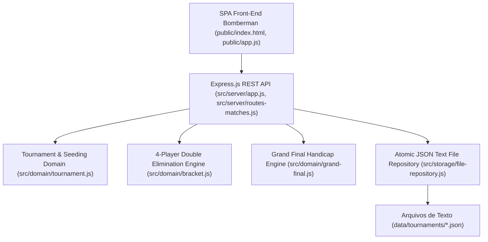

# Bomber Tournament Manager Design

**Spec**: `.specs/features/bomber-tournament/spec.md`
**Status**: Approved

---

## Architecture Overview

A aplicação segue uma arquitetura em 3 camadas desacopladas em Node.js (ES Modules):
1. **Camada de Domínio (`src/domain/`)**: Funções puras e determinísticas que implementam as regras do torneio de Bomberman (validação de múltiplos de 4 entre 16 e 64 jogadores, preenchimento de slots `BOT/BYE` até a potência de 2, geração e progressão das chaves Winners e Losers com 4 jogadores por partida, regra de `undo` e Grande Final com handicap 3 vs 6 vitórias).
2. **Camada de Persistência e API (`src/storage/` e `src/server/`)**: Repositório de arquivos de texto JSON (`data/tournaments/<id>.json`) com escrita atômica via arquivo temporário (`.tmp` + `rename`) e servidor HTTP Express.js que expõe a API REST e serve os arquivos estáticos.
3. **Camada de Apresentação (`public/`)**: Single Page Application (SPA) em HTML5, CSS3 estilo Arcade Retrô e JavaScript ES Modules com ilustrações SVG próprias de Bomberman (avatares nas 8 cores clássicas, bombas, blocos e troféu).



---

## Code Reuse Analysis

### Existing Components to Leverage

| Component | Location | How to Use |
| --------- | -------- | ---------- |
| Repositório Greenfield | `package.json` (novo) | Repositório inicial possui apenas `README.md`, `LICENSE` e `.gitignore`; módulos em `src/domain/` serão reutilizados tanto pela API Express quanto pelos testes unitários e de integração |

### Integration Points

| System | Integration Method |
| ------ | ------------------ |
| Sistema de Arquivos Local (`node:fs/promises`) | Leitura e escrita atômica de arquivos `.json` em `data/tournaments/` |
| Servidor HTTP (`express`) | Rotas REST JSON em `/api/tournaments/*` e arquivos estáticos servidos a partir de `public/` |

---

## Components

### 1. Tournament & Seeding Domain (`src/domain/tournament.js`)

- **Purpose**: Gerenciar criação de torneios em estado `DRAFT`, cadastro/remoção de jogadores com cores de Bomberman, shuffle e ordenação manual de seeding, e validação do limite de participantes ($16 \le N \le 64$, $N \bmod 4 = 0$).
- **Location**: `src/domain/tournament.js`
- **Interfaces**:
  - `createTournament({ name })` - Cria estrutura inicial do torneio com status `DRAFT`.
  - `addPlayer(tournament, { name, color })` - Valida nome único e cor (`white`, `black`, `red`, `blue`, `green`, `yellow`, `pink`, `aqua`) e adiciona jogador.
  - `shufflePlayers(tournament, rng)` - Embaralha a ordem de seeding no estado `DRAFT`.
  - `reorderPlayers(tournament, orderedPlayerIds)` - Atualiza a ordem manual dos jogadores no estado `DRAFT`.
  - `validateCanStart(tournament)` - Garante $16 \le N \le 64$ e $N \bmod 4 = 0$.
- **Dependencies**: `node:crypto` (geração de IDs).
- **Reuses**: N/A (módulo base).

### 2. 4-Player Double Elimination Bracket Engine (`src/domain/bracket.js`)

- **Purpose**: Dimensionar a chave para a potência de 2 ($P \in \{16, 32, 64\}$) com slots `BOT/BYE`, gerar todas as partidas de 4 jogadores da Winners e da Losers, processar o avanço de 2 vencedores e queda/eliminação de 2 perdedores, e permitir desfazer (`undo`) partidas sem confrontos subsequentes concluídos.
- **Location**: `src/domain/bracket.js`
- **Interfaces**:
  - `startTournament(tournament)` - Preenche `BOT/BYE` se $N < P$, constrói rodadas da Winners e Losers com links explícitos (`winnerTarget`, `loserTarget`), resolve auto-avanços iniciais se aplicável e muda status para `IN_PROGRESS`.
  - `recordMatchResult(tournament, matchId, winnerIds)` - Valida 2 vencedores humanos, avança vencedores, envia perdedores da Winners para a Losers (ou elimina na Losers) e transiciona para `GRAND_FINAL` quando os 4 finalistas estão definidos.
  - `undoMatchResult(tournament, matchId)` - Verifica se as partidas de destino continuam não concluídas (`409` caso contrário), limpa os slots propagados e restaura a partida para `READY`.
- **Dependencies**: `src/domain/tournament.js`, `src/domain/grand-final.js`.
- **Reuses**: Estruturas de participantes de `src/domain/tournament.js`.

### 3. Grand Final Handicap Engine (`src/domain/grand-final.js`)

- **Purpose**: Gerenciar a arena da Grande Final com 4 jogadores aplicando handicap de 3 vitórias para finalistas da Winners Bracket e 6 vitórias para finalistas da Losers Bracket.
- **Location**: `src/domain/grand-final.js`
- **Interfaces**:
  - `initGrandFinal(tournament, winnersFinalists, losersFinalists)` - Inicializa os 4 finalistas com `targetWins: 3` (`WINNERS`) e `targetWins: 6` (`LOSERS`).
  - `recordGrandFinalWin(tournament, playerId)` - Soma +1 vitória ao finalista, registra no histórico de rodadas e encerra o torneio (`COMPLETED` + `championId`) se `wins === targetWins`.
  - `undoGrandFinalWin(tournament)` - Remove a última vitória do histórico e reverte `COMPLETED` para `GRAND_FINAL` se necessário.
- **Dependencies**: Nenhuma externa.
- **Reuses**: Modelos de jogador do domínio.

### 4. Atomic Text File Repository (`src/storage/file-repository.js`)

- **Purpose**: Persistir cada torneio em um arquivo de texto JSON formatado (`data/tournaments/<id>.json`) usando escrita atômica (`.tmp` seguido de `rename`).
- **Location**: `src/storage/file-repository.js`
- **Interfaces**:
  - `createFileRepository(dataDir)` - Retorna `{ save(tournament), getById(id), list(), remove(id) }`.
- **Dependencies**: `node:fs/promises`, `node:path`.
- **Reuses**: N/A.

### 5. Express REST API (`src/server/app.js` & `src/server/routes-matches.js`)

- **Purpose**: Expor endpoints HTTP REST para criação/listagem/exclusão de torneios, gestão de jogadores, progressão de partidas e Grande Final, além de servir o front-end estático.
- **Location**: `src/server/app.js`, `src/server/routes-matches.js`
- **Interfaces**:
  - `createApp({ dataDir })` - Configura instância Express com middlewares JSON, rotas REST e arquivos estáticos de `public/`.
  - `registerMatchRoutes(app, repo)` - Registra rotas de resultado/undo de partidas e rodadas da Grande Final.
- **Dependencies**: `express`, módulos de `src/domain/` e `src/storage/file-repository.js`.
- **Reuses**: Todas as funções de domínio e persistência.

### 6. Bomberman Arcade SPA (`public/index.html`, `public/styles.css`, `public/app.js`)

- **Purpose**: Interface visual temática de Bomberman com sprites SVG dos personagens, bombas e troféu, painel de inscrição/seeding, visualização de chaves Winners e Losers com cartões de 4 jogadores e Arena da Grande Final com barras de progresso (0/3 e 0/6).
- **Location**: `public/index.html`, `public/styles.css`, `public/app.js`
- **Interfaces**:
  - Renderização reativa baseada no estado JSON retornado pela API REST.
- **Dependencies**: API REST `/api/tournaments`.
- **Reuses**: Contratos de dados do domínio.

---

## Mathematical Model of the 4-Player Double Elimination Bracket

Para $P = 2^k$ vagas totais ($P \in \{16, 32, 64\}$, com $N$ jogadores humanos e $P - N$ slots `BOT/BYE`):

1. **Winners Bracket**:
   - Cada rodada $r \ge 1$ reduz o número de jogadores ativos na Winners pela metade: $W_r = P / 2^{r-1}$ jogadores em $M_{W,r} = W_r / 4$ partidas de 4 jogadores.
   - A última rodada da Winners ($R_W = k - 1$) tem exatamente **1 partida de 4 jogadores** (`Winners Final`): seus 2 vencedores classificam-se para a **Grande Final** (`origin: WINNERS`, `targetWins: 3`) e seus 2 perdedores caem para a última rodada da Losers (`Losers Final`).
2. **Losers Bracket**:
   - **LR1**: Recebe os $P/2$ perdedores da `WR1` em $P/8$ partidas de 4 jogadores $\rightarrow$ sobram $P/4$ sobreviventes.
   - Para cada rodada subsequente da Winners $r \in \{2, \dots, k-1\}$ que derruba $P / 2^r$ perdedores:
     - **Rodada de Junção (Drop-Merge)**: Os $P / 2^r$ sobreviventes da Losers enfrentam os $P / 2^r$ perdedores recém-caídos da `WR(r)` (total $P / 2^{r-1}$ jogadores em $P / 2^{r+1}$ partidas de 4) $\rightarrow$ sobram $P / 2^r$ sobreviventes.
     - **Rodada de Redução Interna (Survivor Reduction)**: Os $P / 2^r$ sobreviventes enfrentam-se entre si em $P / 2^{r+2}$ partidas de 4 $\rightarrow$ sobram $P / 2^{r+1}$ sobreviventes (exceto após a `Losers Final`, quando já restam exatamente **2 sobreviventes** que vão à **Grande Final** com `origin: LOSERS`, `targetWins: 6`).
   - Exemplo concreto para $P = 16$:
     - `WR1` (4 jogos, 16 jog.) $\rightarrow$ 8 avançam para `WR2`, 8 caem para `LR1`.
     - `LR1` (2 jogos, 8 jog.) $\rightarrow$ 4 avançam para `LR2`, 4 eliminados.
     - `WR2` (2 jogos, 8 jog.) $\rightarrow$ 4 avançam para `WR3`, 4 caem para `LR2`.
     - `LR2` (2 jogos: 4 sobreviventes da `LR1` + 4 caídos da `WR2` = 8 jog.) $\rightarrow$ 4 avançam para `LR3`, 4 eliminados.
     - `LR3` (1 jogo: 4 sobreviventes da `LR2`) $\rightarrow$ 2 avançam para `LR4`, 2 eliminados.
     - `WR3 (Winners Final)` (1 jogo, 4 jog.) $\rightarrow$ **2 avançam para a Grande Final**, 2 caem para `LR4`.
     - `LR4 (Losers Final)` (1 jogo: 2 sobreviventes da `LR3` + 2 caídos da `WR3` = 4 jog.) $\rightarrow$ **2 avançam para a Grande Final**, 2 eliminados.
     - **Grande Final**: 2 da `WR3` (meta 3) + 2 da `LR4` (meta 6) = 4 finalistas!

---

## Data Models

### Tournament Document (`data/tournaments/<id>.json`)

```javascript
{
  id: "tourn_...",
  name: "Copa Super Bomberman",
  status: "DRAFT" | "IN_PROGRESS" | "GRAND_FINAL" | "COMPLETED",
  createdAt: "2026-11-15T12:00:00.000Z",
  updatedAt: "2026-11-15T12:00:00.000Z",
  bracketSize: null | 16 | 32 | 64,
  championId: null | "p_...",
  players: [
    {
      id: "p_1",
      name: "Shirobon",
      color: "white", // white | black | red | blue | green | yellow | pink | aqua
      seed: 1,
      isBot: false,
      status: "ACTIVE" | "LOSERS" | "FINALIST_WINNERS" | "FINALIST_LOSERS" | "ELIMINATED" | "CHAMPION"
    }
  ],
  brackets: {
    winners: [
      {
        roundNumber: 1,
        name: "Winners Round 1",
        matches: [
          {
            id: "W-R1-M1",
            bracket: "WINNERS",
            roundNumber: 1,
            matchNumber: 1,
            status: "PENDING" | "READY" | "COMPLETED",
            slots: ["p_1", "p_2", "p_3", "p_4"],
            winnerIds: [],
            loserIds: [],
            winnerTargets: [
              { matchId: "W-R2-M1", slotIndex: 0 },
              { matchId: "W-R2-M1", slotIndex: 1 }
            ],
            loserTargets: [
              { matchId: "L-R1-M1", slotIndex: 0 },
              { matchId: "L-R1-M1", slotIndex: 1 }
            ]
          }
        ]
      }
    ],
    losers: [ /* rounds LR1..LR(2k-4) with 4-slot matches */ ]
  },
  grandFinal: {
    status: "PENDING" | "READY" | "COMPLETED",
    finalists: [
      { playerId: "p_1", origin: "WINNERS", wins: 0, targetWins: 3 },
      { playerId: "p_5", origin: "WINNERS", wins: 0, targetWins: 3 },
      { playerId: "p_2", origin: "LOSERS", wins: 0, targetWins: 6 },
      { playerId: "p_9", origin: "LOSERS", wins: 0, targetWins: 6 }
    ],
    history: [
      { round: 1, winnerPlayerId: "p_1", timestamp: "..." }
    ]
  }
}
```

---

## Error Handling Strategy

| Error Scenario | Handling | User Impact |
| -------------- | -------- | ----------- |
| Quantidade inválida de jogadores ao iniciar ($N < 16$, $N > 64$ ou $N \bmod 4 \ne 0$) | Domínio lança `ValidationError` (`400 Bad Request`) | Alerta visual no painel informando quantos jogadores faltam para o próximo múltiplo de 4 |
| Seleção diferente de 2 vencedores ou tentativa de selecionar `BOT/BYE` sobre humano | Domínio lança `ValidationError` (`400 Bad Request`) | Botão de confirmar permanece desabilitado até selecionar 2 jogadores humanos válidos |
| Tentativa de desfazer partida cuja rodada seguinte já avançou | Domínio lança `ConflictError` (`409 Conflict`) | Alerta explicando que a partida dependente deve ser desfeita primeiro |
| Torneio ou partida não encontrada | API retorna `404 Not Found` | Notificação de recurso inexistente e atualização da lista |
| Falha de I/O durante gravação | Escrita em `.tmp` antes de `fs.rename` preserva o arquivo `.json` anterior | Erro `500` sem corromper o arquivo do torneio |

---

## Risks & Concerns

| Concern | Location (file:line) | Impact | Mitigation |
| ------- | -------------------- | ------ | ---------- |
| Preenchimento de `BOT/BYE` em torneios com 20, 24 ou 28 jogadores poderia agrupar 3 ou 4 bots na mesma partida | `src/domain/bracket.js` | Partidas sem jogadores humanos suficientes | Distribuir os participantes `BOT/BYE` de forma balanceada (round-robin nas últimas vagas das arenas da `WR1`) e auto-resolver partidas onde restem $\le 2$ humanos |
| Corrupção de arquivo texto em escritas concorrentes | `src/storage/file-repository.js` | Perda de estado do torneio em disco | Serializar escritas por torneio com fila de Promises em memória + escrita atômica via arquivo `.tmp` e `fs.rename` |

---

## Tech Decisions (only non-obvious ones)

| Decision | Choice | Rationale |
| -------- | ------ | --------- |
| Framework HTTP | Express.js (`express`) | Escolhido pelo usuário durante a fase de Design (`AD-001`) |
| Mapeamento de progressão entre partidas | Grafos explícitos de slots (`winnerTargets` e `loserTargets` com `{ matchId, slotIndex }`) | Permite tanto avançar quanto desfazer (`undo`) qualquer partida de forma O(1) e determinística sem recalcular chaves inteiras |
| Test Runner | `node --test --test-reporter=spec` | Nativo do Node.js 22 instalado no ambiente, sem dependências extras e com saída linha a linha compatível com `check_proofs.py` |
